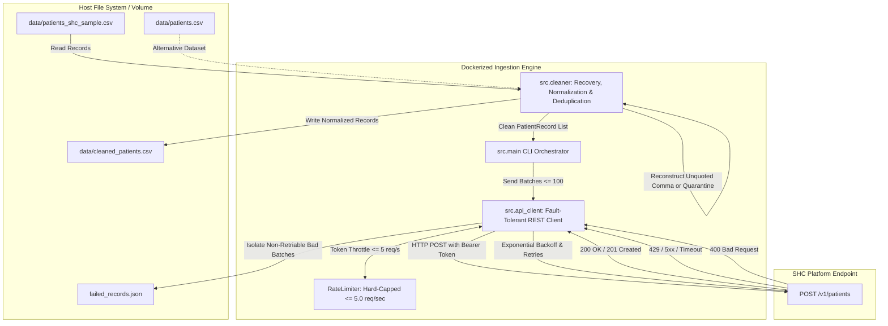

# SHC Technologies – Legacy Patient Data Ingestion & Fault-Tolerant API Integration Engine

[](https://www.python.org/)
[](https://opensource.org/licenses/MIT)
[](https://github.com/psf/black)
[](https://docs.pytest.org/)

Production-grade Forward Deployed Engineer (FDE) integration pipeline for extracting, sanitizing, deduplicating, and securely transmitting legacy healthcare records into modern REST platforms. Built for GlobalHealth Corp integration by SHC Technologies Pvt. Ltd.

---

## Table of Contents

1. [Project Overview](#1-project-overview)
2. [Datasets Provided](#2-datasets-provided)
3. [Architecture & Data Flow](#3-architecture--data-flow)
4. [Technology Stack](#4-technology-stack)
5. [Folder Structure](#5-folder-structure)
6. [CSV Normalization & Malformed Row Recovery](#6-csv-normalization--malformed-row-recovery)
7. [Date Parsing Logic & Supported Formats](#7-date-parsing-logic--supported-formats)
8. [Duplicate Record Handling](#8-duplicate-record-handling)
9. [API Authentication & Integration](#9-api-authentication--integration)
10. [Batch Processing & Absolute Rate Limiting](#10-batch-processing--absolute-rate-limiting)
11. [Exponential Backoff & Retry Logic](#11-exponential-backoff--retry-logic)
12. [Error Handling & Failure Isolation](#12-error-handling--failure-isolation)
13. [Environment Configuration](#13-environment-configuration)
14. [Local Setup Instructions](#14-local-setup-instructions)
15. [Docker Build & Execution Commands](#15-docker-build--execution-commands)
16. [Testing Instructions](#16-testing-instructions)
17. [Assumptions & Limitations](#17-assumptions--limitations)

---

## 1. Project Overview

The **SHC Patient Data Ingestion Engine** is a high-reliability, fault-tolerant Extract-Transform-Load (ETL) and API integration service. It ingests legacy Electronic Health Record (EHR) CSV dumps, resolves data quality anomalies (mixed date encodings, international currency signs, unquoted delimiters, duplicate updates), and prepares validated records for batched, rate-governed transmission to upstream healthcare API endpoints.

> **Note on API Target:** The endpoint `https://api.mock-shc.com/v1/patients` is a mock specification URL. All networking behavior, rate limiting, and retry handling have been verified using automated mock HTTP test harnesses.

---

## 2. Datasets Provided

The project includes three dataset files under the `data/` directory:

1. **`data/patients_shc_sample.csv` (Original Assessment Sample):**
   The exact 9-row dataset provided in page 2 of the official SHC technical assessment task PDF. It features:
   - Duplicate updates for `P-1001` and `P-1003` with different timestamps.
   - Malformed unquoted account balance `1,250.00` for patient `P-1002`.
   - Various date formats (`YYYY-MM-DD`, `MM/DD/YYYY`, `DD-MM-YYYY`).
   - Currency formats (`$150.50`, `€300.00`, `0.00`, `"2,450.75"`, `$-15.00`).
   - Missing email (`P-1002`, `P-1005`) and missing phone (`P-1002`, `P-1006`).

2. **`data/patients.csv` (Comprehensive Demonstration Dataset):**
   An expanded 15-row dataset covering additional real-world edge cases:
   - Accounting negative balances: `($120.50)`
   - Indian Rupee currency: `₹15000.00`
   - Quarantined invalid records: Missing mandatory `patient_id`, missing `last_modified`, invalid calendar date (`1985-02-31`), and non-numeric account balance (`NOT_A_NUMBER`).

3. **`data/patients_corrected.csv` (RFC 4180 Reference Dataset):**
   A reference version of the demonstration data where the unquoted `1,250.00` is properly enclosed in quotes as `"1,250.00"`.

---

## 3. Architecture & Data Flow

### System Architecture Diagram



---

## 4. Technology Stack

- **Runtime:** Python 3.12+ (CPython)
- **Data Manipulation:** Python Standard Library (`csv`, `dataclasses`, `re`, `datetime`)
- **HTTP Networking:** `requests` (v2.34.2+) with `urllib3`
- **Environment Management:** `python-dotenv` (v1.2.4+)
- **Testing & Mocking:** `pytest` (v8.4.2+), `responses` (v0.26.3+)
- **Containerization:** Docker with multi-stage build on `python:3.12-slim`

---

## 5. Folder Structure

```
shc-patient-data-ingestion/
│
├── data/
│   ├── patients_shc_sample.csv   # Exact sample dataset from SHC assessment PDF
│   ├── patients.csv              # Comprehensive demonstration dataset
│   ├── patients_corrected.csv    # Reference RFC 4180 compliant dataset
│   └── cleaned_patients.csv      # Cleaned, normalized, deduplicated output
│
├── src/
│   ├── __init__.py               # Package metadata and version definition
│   ├── cleaner.py                # Task 1: Extraction, normalization, safe recovery & deduplication
│   ├── api_client.py             # Task 2: Rate limiter (<=5 req/s), retry engine, REST client
│   └── main.py                   # Orchestrator CLI entrypoint
│
├── tests/
│   ├── __init__.py               # Test package initialization
│   ├── test_cleaner.py           # Unit tests for Task 1 (DOB, currency, recovery, deduplication)
│   ├── test_api_client.py        # Unit tests for Task 2 (hard cap, batching, 400 isolation, retries)
│   └── test_main.py              # End-to-end integration tests with mocked API
│
├── failed_records.json           # Isolated storage for non-retriable HTTP 400 / exhausted attempts
├── dashboard.html                # Interactive HTML data quality dashboard
├── Dockerfile                    # Production multi-stage Docker build
├── requirements.txt              # Production and testing Python dependencies
├── .env.example                  # Environment template without secrets
├── .env                          # Local environment configuration
├── .dockerignore                 # Excluded paths from Docker image build
├── .gitignore                    # Git version control ignore rules
├── client_communication.md       # Task 4: Client email to GlobalHealth Corp IT Director
└── README.md                     # Comprehensive project documentation
```

---

## 6. CSV Normalization & Malformed Row Recovery

### The Malformed Row Problem
In the sample CSV, row `P-1002` contains:
```text
P-1002,Jane,Smith,12/31/1992,,,1,250.00,2026-10-02T11:30:00Z
```
Because `1,250.00` is unquoted, a standard CSV reader splits the line on the comma, resulting in 9 columns instead of the expected 8:
- Column 6: `1`
- Column 7: `250.00`
- Column 8: `2026-10-02T11:30:00Z`

### Safe Recovery Heuristic
`src/cleaner.py` contains a recovery routine (`attempt_recover_malformed_balance_row`):
1. **Column Count Check:** The row must have exactly one extra column (`len(row) == len(headers) + 1`).
2. **Timestamp Verification:** The final field (`row[-1]`) must parse as a valid ISO `last_modified` timestamp.
3. **Balance Reconstruction:** The split tokens at the `account_balance` column index are joined with `,` (e.g. `1,250.00`) and validated as a valid numeric float (`1250.00`).
4. **Full Field Validation:** Every reconstructed field is validated (`patient_id` non-empty, `dob` valid date).
5. **Ambiguity Defense:** If any check fails or the row structure is ambiguous, the record is **quarantined** rather than guessed, preventing corrupt clinical data from propagating.

---

## 7. Date Parsing Logic & Supported Formats

Dates of birth (`dob`) are normalized to **ISO 8601** format (`YYYY-MM-DD`):

| Input Format | Sample Input | Normalized Output | Description |
| :--- | :--- | :--- | :--- |
| **YYYY-MM-DD** | `1980-05-15` | `1980-05-15` | Standard ISO 8601 date |
| **MM/DD/YYYY** | `12/31/1992` | `1992-12-31` | US legacy format |
| **DD-MM-YYYY** | `25-04-1975` | `1975-04-25` | European legacy format |

Invalid dates (such as `1985-02-31`) are caught by calendar validation and quarantined.

---

## 8. Duplicate Record Handling

When duplicate `patient_id` entries occur:
1. Records are grouped by `patient_id`.
2. Their `last_modified` timestamps are parsed into timezone-aware UTC `datetime` objects.
3. Records are sorted in descending order of `last_modified`.
4. The record with the latest timestamp is retained; older revisions are pruned.
5. In the assessment sample:
   - `P-1001`: Record from `2026-10-05T14:20:00Z` is kept; record from `2026-09-28T08:00:00Z` is retired.
   - `P-1003`: Record from `2026-10-03T09:15:00Z` is kept; record from `2026-09-20T10:00:00Z` is retired.

---

## 9. API Authentication & Integration

- **Endpoint:** `POST https://api.mock-shc.com/v1/patients` (configurable via `API_BASE_URL`).
- **Authentication:** `Authorization: Bearer <API_TOKEN>`.
- **Credential Masking:** Secret tokens are masked in all logs (e.g. `mo****-xyz`), ensuring compliance with security standards.

---

## 10. Batch Processing & Absolute Rate Limiting

- **Batching:** `chunk_records()` partitions patient arrays into batches of up to 100 records (`BATCH_SIZE=100`).
- **Hard Rate Limit:** The `RateLimiter` enforces an **absolute ceiling of at most 5.0 requests per second** using a sliding-window tracker. Even if `RATE_LIMIT_RPS` is set to a higher value (e.g. `10` or `50`), the rate limiter clamps execution to `5.0 req/s`.

---

## 11. Exponential Backoff & Retry Logic

- **Transient Errors:** Retried on HTTP 429, HTTP 5xx, and network timeouts.
- **Backoff Formula:** $\text{delay} = \min(\text{max\_delay},\ \text{initial\_backoff} \times \text{backoff\_factor}^{(\text{attempt} - 1)}) + \text{jitter}$
- **Retry Count Definition:** `MAX_RETRIES` represents the number of retry attempts *after* an initial failure. For example, with `MAX_RETRIES=3`, the client will make 1 initial request and up to 3 retries (total 4 attempts) before isolating the batch.
- **Retry-After Header:** Dynamically honored if returned on HTTP 429.

---

## 12. Error Handling & Failure Isolation

- **HTTP 400 Bad Request:** Non-retriable. The failing batch is isolated into `failed_records.json` with timestamp, status code, error detail, and record payload. Ingestion continues for subsequent batches.
- **Retries Exhausted:** Recorded into `failed_records.json` with error type `RETRIES_EXHAUSTED`.

---

## 13. Environment Configuration

| Variable | Default Value | Description |
| :--- | :--- | :--- |
| `API_BASE_URL` | `https://api.mock-shc.com/v1/patients` | Target REST API endpoint |
| `API_TOKEN` | `""` | Bearer authentication token |
| `INPUT_FILE` | `data/patients_shc_sample.csv` | Input CSV path |
| `OUTPUT_FILE` | `data/cleaned_patients.csv` | Cleaned CSV path |
| `FAILED_RECORDS_FILE` | `failed_records.json` | Failed records JSON path |
| `BATCH_SIZE` | `100` | Maximum records per API request |
| `MAX_RETRIES` | `3` | Maximum retry attempts after initial failure |
| `RATE_LIMIT_RPS` | `5.0` | Desired requests/sec (strictly capped at 5.0) |
| `LOG_LEVEL` | `INFO` | Console logging verbosity |

---

## 14. Local Setup Instructions

```bash
# 1. Activate virtual environment
.\.venv\Scripts\Activate.ps1   # Windows PowerShell
source .venv/bin/activate       # Linux/macOS

# 2. Run extraction on original SHC sample:
python -m src.main --input data/patients_shc_sample.csv --dry-run

# 3. Run extraction on demonstration dataset:
python -m src.main --input data/patients.csv --dry-run
```

---

## 15. Docker Build & Execution Commands

```bash
# Build production Docker image
docker build -t shc-patient-ingestion:1.0.0 .

# Run container with volume mount in dry-run mode
docker run --rm -v $(pwd)/data:/app/data shc-patient-ingestion:1.0.0 --dry-run
```

---

## 16. Testing Instructions

```bash
# Run complete test suite:
pytest -v
```

All 36 tests cover date normalization, currency parsing, malformed unquoted comma recovery, ambiguous record quarantine, duplicate deduplication, rate limit hard-capping, exponential backoff, and mock API integration.

---

## 17. Assumptions & Limitations

1. **Date Ambiguity:** Resolved by separator: `/` indicates `MM/DD/YYYY`, `-` with two leading digits indicates `DD-MM-YYYY`, and `-` with four leading digits indicates `YYYY-MM-DD`.
2. **Missing Contacts:** In line with healthcare workflows, patients without recorded emails or phone numbers remain valid clinical entities; their contact fields are populated with empty strings.
3. **Mock API:** The target endpoint is a mock specification URL. Network interactions are validated via automated mock tests.
