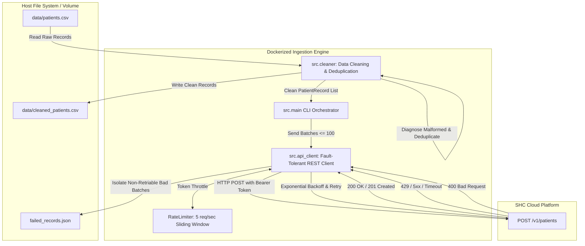
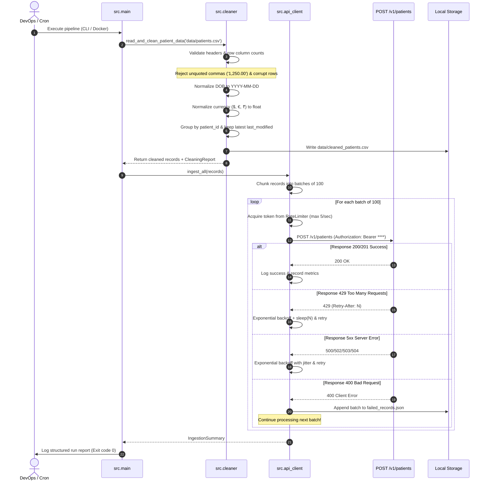

# SHC Technologies – Legacy Patient Data Ingestion & Fault-Tolerant API Integration Engine

[](https://www.python.org/)
[](https://opensource.org/licenses/MIT)
[](https://github.com/psf/black)
[](https://docs.pytest.org/)

Production-ready Forward Deployed Engineer (FDE) integration pipeline for extracting, sanitizing, deduplicating, and securely transmitting legacy healthcare records into modern REST platforms. Built for GlobalHealth Corp integration by SHC Technologies Pvt. Ltd.

---

## Table of Contents

1. [Project Overview](#1-project-overview)
2. [Business Problem & Solution](#2-business-problem--solution)
3. [Architecture & Data Flow](#3-architecture--data-flow)
4. [Technology Stack](#4-technology-stack)
5. [Folder Structure](#5-folder-structure)
6. [CSV Normalization Approach](#6-csv-normalization-approach)
7. [Date Parsing Logic & Supported Formats](#7-date-parsing-logic--supported-formats)
8. [Duplicate Record Handling](#8-duplicate-record-handling)
9. [API Authentication & Integration](#9-api-authentication--integration)
10. [Batch Processing & Rate Limiting](#10-batch-processing--rate-limiting)
11. [Exponential Backoff Implementation](#11-exponential-backoff-implementation)
12. [Error Handling & Failure Isolation](#12-error-handling--failure-isolation)
13. [Environment Configuration](#13-environment-configuration)
14. [Local Setup Instructions](#14-local-setup-instructions)
15. [Docker Build & Execution Commands](#15-docker-build--execution-commands)
16. [Testing Instructions](#16-testing-instructions)
17. [Assumptions & Limitations](#17-assumptions--limitations)

---

## 1. Project Overview

The **SHC Patient Data Ingestion Engine** is a high-reliability, fault-tolerant Extract-Transform-Load (ETL) and API integration service. It ingests legacy Electronic Health Record (EHR) CSV dumps from partner hospital networks, resolves pervasive data quality anomalies (mixed date encodings, international currency signs, unquoted delimiters, duplicate updates), and transmits validated records in batched, rate-governed transactions to upstream healthcare API endpoints.

---

## 2. Business Problem & Solution

### The Business Challenge
Healthcare data exchanges frequently encounter legacy data exports characterized by:
- **Syntactic Corruption:** Incomplete quoting of currency values containing commas (e.g. `1,250.00` emitted without RFC 4180 quotes), which fragments CSV rows into incorrect column alignments.
- **Heterogeneous Date Encodings:** Inconsistent date representations across facilities (`MM/DD/YYYY`, `DD-MM-YYYY`, `YYYY-MM-DD`).
- **Currency & Accounting Variances:** Mixtures of `$`, `€`, `₹`, `£`, commas, and accounting parentheses representing negative balances (`($120.50)`).
- **Duplicate & Out-of-Order Updates:** Multiple records for the same patient across time.
- **Strict Target API Quotas:** Strict rate limits (5 req/sec), payload limits (100 records/batch), and transient server errors (HTTP 429, 5xx) requiring resilient backoff.

### The Solution
A decoupled, two-phase pipeline:
1. **Extraction & Normalization Engine (`src/cleaner.py`):** Parses raw CSV data, detects and rejects malformed rows to prevent downstream database pollution, standardizes fields to ISO 8601, cleans currency to IEEE floating-point numbers, and deduplicates patient records by their latest update timestamp.
2. **Resilient API Transmission Engine (`src/api_client.py`):** Partitions cleaned data into chunks of 100, governs transmission with a 5 req/sec sliding-window rate limiter, retries 429/5xx errors using jittered exponential backoff, and isolates non-retriable 400 Bad Request batches into `failed_records.json` without aborting the pipeline.

---

## 3. Architecture & Data Flow

### System Architecture Diagram



### Data Processing Flow



---

## 4. Technology Stack

- **Runtime:** Python 3.12+ (CPython)
- **Data Manipulation:** Python Standard Library (`csv`, `dataclasses`, `re`, `datetime`)
- **HTTP Networking:** `requests` (v2.34.2+) with `urllib3`
- **Environment Management:** `python-dotenv` (v1.2.4+)
- **Testing & Mocking:** `pytest` (v8.4.2+), `responses` (v0.26.3+)
- **Containerization:** Docker with multi-stage build on `python:3.12-slim`

---

## 5. Folder Structure

```
shc-patient-data-ingestion/
│
├── data/
│   ├── patients.csv              # Raw sample dataset with real-world edge cases
│   ├── patients_corrected.csv    # Reference RFC 4180 corrected dataset
│   └── cleaned_patients.csv      # Cleaned, normalized, deduplicated output
│
├── src/
│   ├── __init__.py               # Package metadata and version definition
│   ├── cleaner.py                # Task 1: Extraction, normalization, and deduplication
│   ├── api_client.py             # Task 2: Rate limiter, retry engine, and REST client
│   └── main.py                   # Orchestrator CLI entrypoint
│
├── tests/
│   ├── __init__.py               # Test package initialization
│   ├── test_cleaner.py           # Unit tests for date parsing, currency, and deduplication
│   ├── test_api_client.py        # Unit tests for rate limiting, retries, and HTTP 400 handling
│   └── test_main.py              # End-to-end integration tests with mocked API
│
├── failed_records.json           # Isolated records from HTTP 400 / exhausted attempts
├── Dockerfile                    # Production multi-stage Docker build
├── requirements.txt              # Production and testing Python dependencies
├── .env.example                  # Environment template without secrets
├── .env                          # Local environment configuration
├── .dockerignore                 # Excluded paths from Docker image build
├── .gitignore                    # Git version control ignore rules
├── client_communication.md       # Task 4: Client email to GlobalHealth Corp IT Director
└── README.md                     # Comprehensive project documentation
```

---

## 6. CSV Normalization Approach

The extraction engine operates line-by-line using Python’s standard `csv` module to prevent memory bottlenecks on large dumps:

1. **Header Validation:** Enforces the presence of mandatory columns (`patient_id`, `last_modified`).
2. **Missing Contact Data:** Missing `email` and `phone` values are normalized to empty strings (`""`) without crashing.
3. **The Malformed Row Issue (`1,250.00`):**
   - In raw CSV exports, if an account balance such as `1,250.00` is unquoted, standard CSV readers split it across the comma into two columns (`1` and `250.00`), creating 9 columns instead of the expected 8.
   - Naive parsers either crash or shift subsequent columns, misassigning values.
   - **Our Handling:** `src/cleaner.py` compares row length with expected column count. When a 9-column row with an unquoted currency comma is detected, it logs a clear RFC 4180 explanation and rejects the corrupt record to prevent silent data corruption.
4. **Currency Standardization:**
   - Strips `$`, `€`, `₹`, and `£`.
   - Strips thousands commas (e.g. `1,250.00` &rarr; `1250.00`).
   - Retains negative signs (`-$50.00`, `-50.00`) and converts accounting parentheses (`($120.50)` &rarr; `-120.50`).
   - Converts to standard Python `float` rounded to two decimal places.

---

## 7. Date Parsing Logic & Supported Formats

Dates of birth (`dob`) are normalized to **ISO 8601** format (`YYYY-MM-DD`):

| Input Format | Regex Pattern | Input Sample | Normalized Output |
| :--- | :--- | :--- | :--- |
| **YYYY-MM-DD** | `^\d{4}-\d{1,2}-\d{1,2}$` | `1990-11-23` | `1990-11-23` |
| **MM/DD/YYYY** | `^\d{1,2}/\d{1,2}/\d{4}$` | `04/15/1985` | `1985-04-15` |
| **DD-MM-YYYY** | `^\d{1,2}-\d{1,2}-\d{4}$` | `23-08-1976` | `1976-08-23` |

Invalid calendar dates (e.g., `1985-02-31` or `31-04-2000`) are detected using Python calendar validation, logged with the exact reason, and safely rejected.

---

## 8. Duplicate Record Handling

When multiple updates exist for the same `patient_id`:
1. Records are grouped by `patient_id`.
2. Each record's `last_modified` timestamp is parsed into a timezone-aware UTC `datetime` object.
3. The records are sorted in descending order of `last_modified`.
4. The record with the latest timestamp is retained; older records are discarded.
5. Deduplication metrics are logged (kept timestamp vs. discarded count).

---

## 9. API Authentication & Integration

- **Endpoint:** `POST https://api.mock-shc.com/v1/patients` (configurable via `API_BASE_URL`).
- **Authentication:** HTTP Authorization header: `Authorization: Bearer <API_TOKEN>`.
- **Credential Masking:** Tokens are strictly redacted in log output (e.g., `mo****-xyz`), ensuring compliance with HIPAA, SOC 2, and ISO 27001 auditing standards.

---

## 10. Batch Processing & Rate Limiting

- **Batching:** `chunk_records()` groups normalized records into batches of up to 100 items (`BATCH_SIZE=100`).
- **Rate Limiting:** `RateLimiter` implements a sliding-window algorithm that measures request timestamps over a 1.0-second rolling interval. If 5 requests have been dispatched within the current window, subsequent requests are automatically throttled, strictly guaranteeing that outbound traffic **never exceeds 5 requests per second**.

---

## 11. Exponential Backoff Implementation

For transient errors, the client calculates backoff with uniform random jitter to avoid thundering-herd conditions:

$$\text{delay} = \min\left(\text{max\_delay},\ \text{initial\_backoff} \times \text{backoff\_factor}^{(\text{attempt} - 1)}\right) + \text{jitter}$$

- **HTTP 429 (Too Many Requests):** If the response includes a `Retry-After` header, that value is honored; otherwise, exponential backoff is applied.
- **HTTP 5xx (Server Errors) & Timeouts:** Automatically retried up to `MAX_RETRIES` (default: 3).

---

## 12. Error Handling & Failure Isolation

### HTTP 400 Bad Request
HTTP 400 indicates an invalid payload that will not succeed upon retry. The client:
1. Logs the HTTP 400 error and server message.
2. Extracts the failing batch.
3. Appends the batch, timestamp, status code, and payload to `failed_records.json`.
4. **Continues execution:** Ingestion proceeds with the remaining batches.

### Network Timeouts & Exhausted Retries
If retries are exhausted without receiving a 2xx response, the batch is appended to `failed_records.json` with error type `RETRIES_EXHAUSTED`, and a detailed warning is emitted.

---

## 13. Environment Configuration

All settings are configured through environment variables or a `.env` file:

| Variable | Default Value | Description |
| :--- | :--- | :--- |
| `API_BASE_URL` | `https://api.mock-shc.com/v1/patients` | Target REST API endpoint |
| `API_TOKEN` | `""` | Bearer authentication token |
| `INPUT_FILE` | `data/patients.csv` | Path to raw patient CSV |
| `OUTPUT_FILE` | `data/cleaned_patients.csv` | Path to save cleaned CSV |
| `FAILED_RECORDS_FILE` | `failed_records.json` | Path to store failed 400/retried records |
| `BATCH_SIZE` | `100` | Maximum records per API request |
| `MAX_RETRIES` | `3` | Maximum retry attempts for 429/5xx/network errors |
| `RATE_LIMIT_RPS` | `5.0` | Maximum allowed requests per second |
| `INITIAL_BACKOFF` | `1.0` | Initial exponential backoff delay in seconds |
| `BACKOFF_FACTOR` | `2.0` | Multiplier for exponential backoff |
| `LOG_LEVEL` | `INFO` | Logging level (`DEBUG`, `INFO`, `WARNING`, `ERROR`) |

---

## 14. Local Setup Instructions

### Prerequisites
- Python 3.12+
- `pip` or `uv`

### Installation
```bash
# Clone the repository
git clone https://github.com/shc-technologies/shc-patient-data-ingestion.git
cd shc-patient-data-ingestion

# Create and activate virtual environment
python -m venv .venv

# On Linux/macOS:
source .venv/bin/activate
# On Windows PowerShell:
.\.venv\Scripts\Activate.ps1

# Install dependencies
pip install -r requirements.txt

# Copy environment template
cp .env.example .env
```

### Execution
```bash
# Run data extraction & cleaning only (dry-run):
python -m src.main --dry-run

# Run full pipeline with API transmission:
python -m src.main

# Run with custom input and output paths:
python -m src.main --input data/patients_corrected.csv --output data/cleaned_patients.csv
```

---

## 15. Docker Build & Execution Commands

### Build Image
```bash
docker build -t shc-patient-ingestion:1.0.0 .
```

### Run Container
```bash
# Using volume mount for persistent input/output:
docker run --rm \
  -e API_BASE_URL="https://api.mock-shc.com/v1/patients" \
  -e API_TOKEN="your-secure-bearer-token" \
  -v $(pwd)/data:/app/data \
  shc-patient-ingestion:1.0.0

# Using .env file:
docker run --rm \
  --env-file .env \
  -v $(pwd)/data:/app/data \
  shc-patient-ingestion:1.0.0

# Running dry-run mode inside Docker:
docker run --rm \
  -v $(pwd)/data:/app/data \
  shc-patient-ingestion:1.0.0 --dry-run
```

---

## 16. Testing Instructions

The test suite provides comprehensive coverage of all data edge cases, rate limiting, and mock API interactions:

```bash
# Run complete test suite:
pytest -v

# Run with coverage report:
pytest -v --cov=src --cov-report=term-missing
```

### Test Coverage Summary
- **DOB Normalization:** `YYYY-MM-DD`, `MM/DD/YYYY`, `DD-MM-YYYY`, single-digit components, invalid dates (Feb 31, April 31).
- **Currency & Balance:** `$`, `€`, `₹`, `£`, commas, negative balances, accounting parentheses `($120.50)`.
- **Deduplication:** Grouping by `patient_id`, preserving latest `last_modified` timestamp.
- **Malformed Rows:** Detection of unquoted commas splitting `1,250.00` into 9 columns.
- **API Batching:** Chunking into batches of 100.
- **Rate Limiting:** Enforcing maximum 5 requests per second.
- **Retry Handling:** HTTP 429 with `Retry-After`, HTTP 5xx with exponential backoff, connection timeouts.
- **Failure Isolation:** Non-retriable HTTP 400 batches saved to `failed_records.json` while subsequent batches continue.

---

## 17. Assumptions & Limitations

1. **Date Ambiguity:** Date components are resolved based on delimiters: `/` indicates `MM/DD/YYYY` (US standard), while `-` with two leading digits indicates `DD-MM-YYYY` (European standard), and four leading digits indicates `YYYY-MM-DD` (ISO 8601).
2. **Missing Contacts:** In line with healthcare workflows, patients without recorded emails or phone numbers remain valid clinical entities; their contact fields are populated with empty strings.
3. **Mock API Verification:** The target endpoint `https://api.mock-shc.com/v1/patients` is a mock specification URL. The application explicitly tracks real HTTP responses and will never claim records have been uploaded unless an HTTP 2xx status code is verified.
4. **RFC 4180 Upstream Standard:** Upstream CSV extractors should wrap fields containing commas in double quotation marks to prevent malformed rows.
